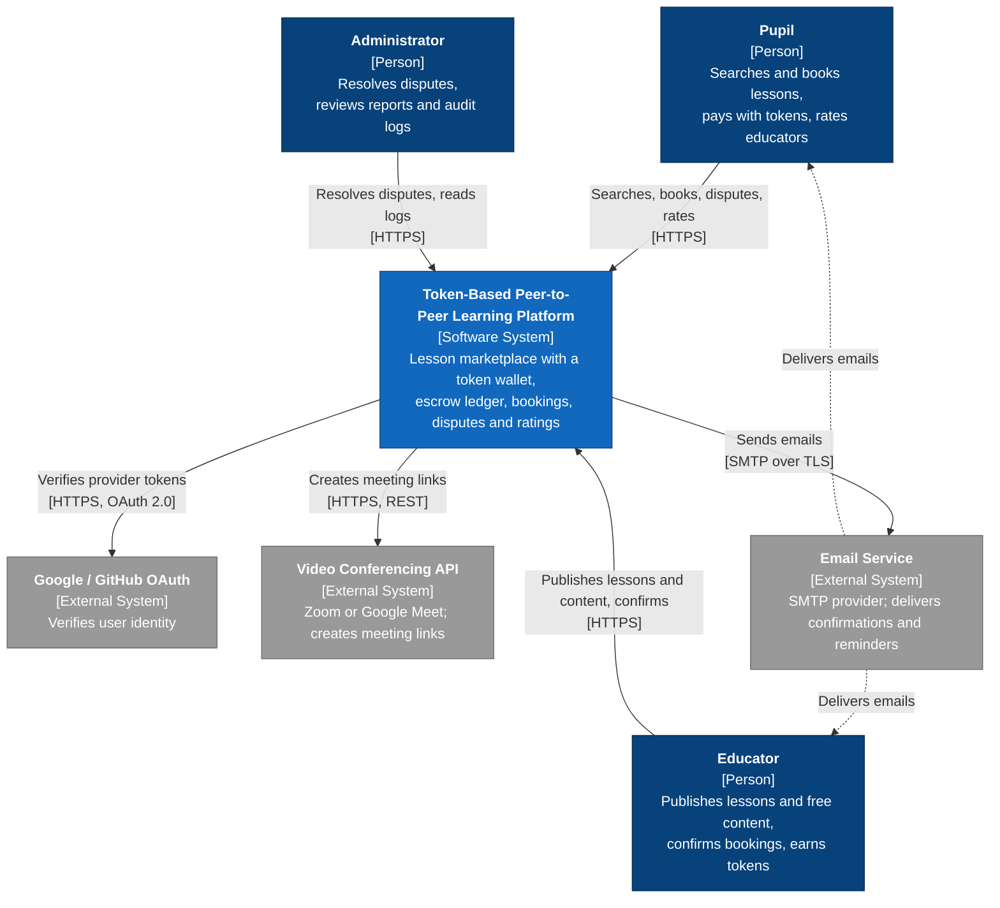
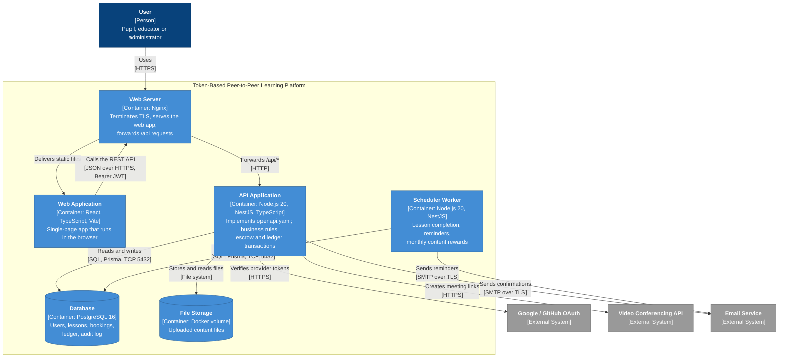

# C4 Model

**Project:** Token-Based Peer-to-Peer Learning Platform
**Sprint:** 2 – Requirements and Architecture
**Owner:** Arda Eyce (Architect)
**GitHub issues:** #93 (S2-D4), #94 (Context and Container), #95 (Component)

This document describes the architecture with the first three levels of the [C4 model](https://c4model.com/): System Context, Container, and Component. Each level zooms into one element of the level above, so the three diagrams use the same names. The diagrams are written in Mermaid, so GitHub renders them directly;

**Notation:** blue boxes are people, the dark box is our system or one of its containers, grey boxes are external systems, and the cylinder is a data store. Every arrow is labelled with its purpose and protocol.

## 1. Level 1 – System Context

The platform is used by three kinds of people and depends on three external services. Pupils and educators are the same kind of account: one user can learn and teach. Administrators are platform operators with the `ADMIN` role.

| Element | Responsibility | Interaction with the platform |
|---|---|---|
| Pupil | Finds and books lessons, opens disputes, rates educators | Web browser over HTTPS |
| Educator | Publishes listings and free content, confirms bookings | Web browser over HTTPS |
| Administrator | Resolves disputes, reviews reports and the audit log | Web browser over HTTPS, `ADMIN` role required |
| Google / GitHub OAuth | Proves the user's identity; the platform stores no passwords | The platform verifies the provider token on sign-in |
| Video Conferencing API | Creates a meeting link for a confirmed booking | Called after confirmation; a stub is used if it is unavailable |
| Email Service | Delivers booking confirmations and reminders | Called after confirmation and before the lesson; failures never change a booking (BR-11) |

**System boundary:** the platform owns users, profiles, lessons, bookings, the token ledger, disputes, ratings, messages, content, reports, and the audit log. It does not own identities (OAuth), video meetings, or email delivery; it only calls those services.

## 2. Level 2 – Containers

The platform is a modular monolith deployed as five containers with Docker Compose. The API and the scheduler worker are two processes built from the same TypeScript code base, so business rules exist only once.

| Container | Technology | Responsibility | Interfaces |
|---|---|---|---|
| Web Server | Nginx | Terminates HTTPS, serves the built web app, forwards `/api/*` to the API | HTTPS 443 for users; HTTP to the API inside the Docker network |
| Web Application | React, TypeScript, Vite | Screens from the Figma prototype ([docs/ux](../ux/README.md)); keeps the access token in memory | Calls the REST API described by [openapi.yaml](../../openapi.yaml) |
| API Application | Node.js 20, NestJS, TypeScript, Prisma | Implements every operation of `openapi.yaml`; validates input; runs escrow and ledger changes in database transactions | REST/JSON under `/api`, Bearer JWT, errors as `application/problem+json` |
| Scheduler Worker | Node.js 20, NestJS (same code base, no HTTP port) | Completes lessons after the dispute deadline (US-12), sends lesson reminders (US-16), pays monthly content rewards (US-19) | No public interface; uses the same services and database as the API |
| Database | PostgreSQL 16 | Single source of truth; balances are derived from ledger entries | SQL over TCP 5432, reachable only inside the Docker network |
| File Storage | Docker volume | Content files uploaded by educators (PDF, PNG, JPEG, MP4) | Mounted into the API container |

## 3. Level 3 – Components of the API Application

The API is divided into NestJS modules. Each module owns its database tables and exposes services to the other modules; a module never writes another module's tables directly. Only the Ledger module writes ledger entries, which keeps every token movement in one place (BR-03, NFR-07).

```mermaid
flowchart TB
    spa["<b>Web Application</b><br/>[Container: React]"]
    worker["<b>Scheduler Worker</b><br/>[Container]<br/>Completion, reminder and reward jobs"]

    subgraph api ["API Application [Container: Node.js, NestJS]"]
        auth["<b>Auth</b><br/>[Component]<br/>Sign-in, JWT, role guard"]
        users["<b>Users</b><br/>[Component]<br/>Profiles, skills, availability"]
        lessons["<b>Lessons</b><br/>[Component]<br/>Listings, search, price guidance"]
        bookings["<b>Bookings and Escrow</b><br/>[Component]<br/>Booking life cycle, escrow hold,<br/>release and refund"]
        disputes["<b>Disputes</b><br/>[Component]<br/>Dispute window, admin resolution"]
        ratings["<b>Ratings</b><br/>[Component]<br/>One rating per lesson, scores"]
        messages["<b>Messages</b><br/>[Component]<br/>Booking messages"]
        content["<b>Content</b><br/>[Component]<br/>Free content, usage counting"]
        admin["<b>Reports and Admin</b><br/>[Component]<br/>Reports, audit log queries"]
        ledger["<b>Wallet and Ledger</b><br/>[Component]<br/>Only writer of ledger entries,<br/>derived balances"]
        audit["<b>Audit Log</b><br/>[Component]<br/>Append-only record of<br/>ledger and admin actions"]
        notify["<b>Notifications</b><br/>[Component]<br/>Email adapter + stub"]
        meetings["<b>Meetings</b><br/>[Component]<br/>Video API adapter + stub"]
    end

    db[("<b>Database</b><br/>[PostgreSQL]")]
    files[("<b>File Storage</b>")]
    oauth["<b>Google / GitHub OAuth</b><br/>[External]"]
    video["<b>Video Conferencing API</b><br/>[External]"]
    email["<b>Email Service</b><br/>[External]"]

    spa -- "REST/JSON" --> auth
    spa -- "REST/JSON" --> users
    spa -- "REST/JSON" --> lessons
    spa -- "REST/JSON" --> bookings
    spa -- "REST/JSON" --> disputes
    spa -- "REST/JSON" --> ratings
    spa -- "REST/JSON" --> messages
    spa -- "REST/JSON" --> content
    spa -- "REST/JSON" --> admin
    spa -- "REST/JSON" --> ledger

    auth -- "verifies token" --> oauth
    auth -- "creates user, welcome grant" --> users
    auth -- "WELCOME_GRANT" --> ledger
    lessons -- "educator skills, availability, rating" --> users
    bookings -- "reads listing price" --> lessons
    bookings -- "ESCROW_HOLD / RELEASE / REFUND" --> ledger
    bookings -- "creates link" --> meetings
    bookings -- "booking confirmed event" --> notify
    disputes -- "locks booking, resolves" --> bookings
    disputes -- "records decision" --> audit
    ratings -- "checks COMPLETED status" --> bookings
    messages -- "checks participants" --> bookings
    content -- "stores files" --> files
    admin -- "reads" --> audit
    ledger -- "records every movement" --> audit
    worker -- "completes lessons" --> bookings
    worker -- "CONTENT_REWARD" --> content
    worker -- "reminders" --> notify
    meetings -- "HTTPS" --> video
    notify -- "SMTP" --> email
    api -- "Prisma, SQL" --> db

    classDef component fill:#85bbf0,stroke:#5d82a8,color:#000000
    classDef container fill:#438dd5,stroke:#2e6295,color:#ffffff
    classDef external fill:#999999,stroke:#6b6b6b,color:#ffffff
    class auth,users,lessons,bookings,disputes,ratings,messages,content,admin,ledger,audit,notify,meetings component
    class spa,worker,db,files container
    class oauth,video,email external
```

### 3.1 Component responsibilities and interfaces

The operation IDs are the `operationId` values in [openapi.yaml](../../openapi.yaml).

| Component | Responsibility | Provided interface (API operations) | Uses | Stories |
|---|---|---|---|---|
| Auth | Verifies the Google or GitHub token, creates the account on first sign-in, issues a short-lived JWT, checks the `ADMIN` role for `/admin/*` | `loginUser` | OAuth adapter, Users, Wallet and Ledger | US-01, US-03 |
| Users | Stores profiles, skills, interests and weekly availability; validates availability ranges | `getMyProfile`, `updateMyProfile`, `getUserProfile` | – | US-02 |
| Lessons | Stores listings, computes the suggested price and the ±50% range, searches by subject, level, time, maximum price and minimum rating | `searchLessons`, `createLesson`, `getPriceSuggestion` | Users (skills, availability, rating) | US-06, US-07, US-08 |
| Bookings and Escrow | Owns the booking state machine; copies `tokenCost` from the listing; holds, releases and refunds tokens in one transaction with the booking change | `createBooking`, `getBooking`, `confirmBooking`, `cancelBooking` | Lessons, Wallet and Ledger, Meetings, Notifications | US-09, US-10, US-11, US-12, US-15 |
| Disputes | Accepts disputes until `disputeDeadline`; lets administrators resolve them with refund, release or no-show | `openDispute`, `listDisputes`, `resolveDispute` | Bookings and Escrow, Audit Log | US-13, US-14 |
| Ratings | Accepts one rating per participant per completed lesson and updates the user score | `rateBooking` | Bookings and Escrow, Users | US-17 |
| Messages | Stores text messages of a booking; only its two participants can read or send them | `listBookingMessages`, `sendBookingMessage` | Bookings and Escrow | US-20 |
| Content | Stores free content and files, rejects unsupported types, counts unique users who open it | `publishContent`, `listUserContents`, `getContent` | File storage, Bookings (who completed a lesson) | US-18, US-19 |
| Reports and Admin | Stores user reports and gives administrators read access to reports and the audit log | `createReport`, `listReports`, `listAuditLogs` | Audit Log | US-21 |
| Wallet and Ledger | The only component that writes ledger entries; derives `tokenBalance` and `heldTokens`; rejects movements that would make a balance negative; prevents duplicate entries | `getWalletBalance`, `listWalletTransactions` | Audit Log | US-03, US-04, US-05, US-19 |
| Audit Log | Append-only record of every ledger movement and administrator action | Internal only | – | US-14, US-21 |
| Notifications | Sends confirmation and reminder emails through an adapter; a failed email is logged and retried, never rolled back into the booking | Internal only | Email service or stub | US-16 |
| Meetings | Creates meeting links through an adapter for Zoom or Google Meet, or a stub | Internal only | Video API or stub | US-15 |

### 3.2 Scheduler worker jobs

The worker has no HTTP interface. It runs three jobs that call the same services as the API.

| Job | Schedule | What it does | Safety rule |
|---|---|---|---|
| Lesson completion | Every 5 minutes | Completes `CONFIRMED` bookings whose `disputeDeadline` has passed and pays the educator with `ESCROW_RELEASE` | Locks the booking row; the unique ledger key `(booking, ESCROW_RELEASE)` makes a second run harmless (BR-13, NFR-08) |
| Lesson reminder | Every 15 minutes | Emails both participants of lessons that start within the next 24 hours | A reminder is marked as sent, so it is sent once |
| Content reward | First day of each month | Pays 1 token per 10 unique users who opened the content and completed a lesson, at most 20 tokens per educator per month | The unique ledger key `(educator, CONTENT_REWARD, month)` allows one payment per month |

## 4. Consistency between the levels

| Context element | Container | Components |
|---|---|---|
| Pupil, Educator, Administrator | Web Application through the Web Server | All components with a provided interface |
| Google / GitHub OAuth | API Application | Auth |
| Video Conferencing API | API Application | Meetings |
| Email Service | API Application, Scheduler Worker | Notifications |
| – | Database | Every component through its own tables |
| – | File Storage | Content |
