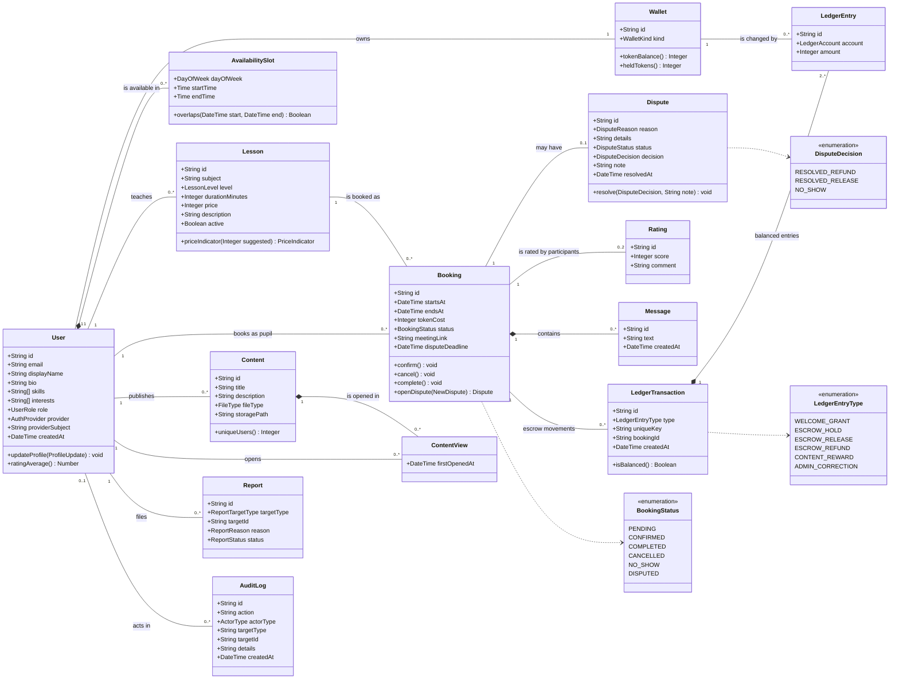
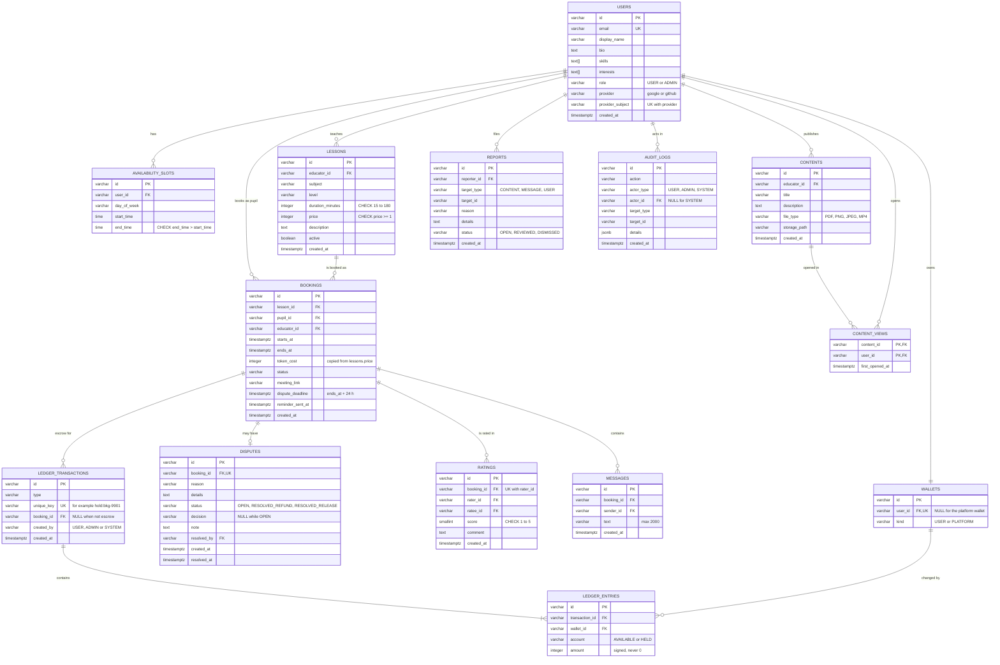
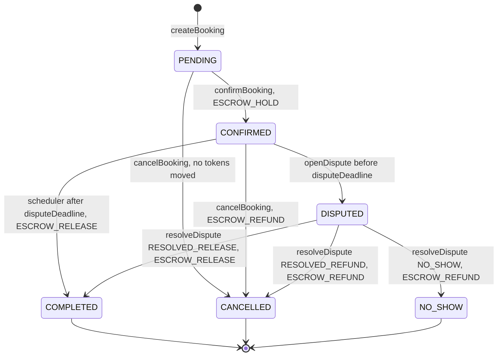

# Data Model

**Project:** Token-Based Peer-to-Peer Learning Platform
**Sprint:** 2 – Requirements and Architecture
**Owner:** Arda Eyce (Architect)
**GitHub issue:** #96 (UML class diagram and database schema), part of #93

This document describes the domain model in two views. The UML class diagram shows the domain objects, their behavior and their relationships. The ER diagram shows how the same objects are stored in PostgreSQL, with keys and the constraints that protect the business rules. Field names match the schemas in [openapi.yaml](../../openapi.yaml); the database uses `snake_case` for the same fields.

## 1. UML class diagram

### 1.1 Classes

| Class | Meaning | Important rules |
|---|---|---|
| User | One account that can learn and teach. `ADMIN` is given by the platform team | Created on first OAuth sign-in; identified by `provider` + `providerSubject`, no password (NFR-06) |
| AvailabilitySlot | A weekly time range of a user | `endTime` must be later than `startTime` (`INVALID_AVAILABILITY_RANGE`) |
| Wallet | Token account of a user; one extra `PLATFORM` wallet is the source of new tokens | Balances are never stored; they are computed from ledger entries (BR-03) |
| LedgerTransaction | One logical token movement, for example "hold 10 tokens for booking bkg-9901" | Its entries add up to zero; `uniqueKey` makes it happen at most once (NFR-08) |
| LedgerEntry | One line of a transaction that changes one wallet's available or held tokens | Never updated or deleted; a correction is a new `ADMIN_CORRECTION` transaction (BR-03) |
| Lesson | A listing of an educator | `price` within ±50% of the suggested price (BR-05) |
| Booking | A pupil's reservation of a lesson slot | `tokenCost` is copied from the lesson (BR-01); status changes follow §3 |
| Dispute | A pupil's complaint about a confirmed lesson | At most one per booking; opened until `disputeDeadline` (BR-08) |
| Rating | A score from one participant about the other | One per participant per completed booking (BR-09) |
| Message | A text message inside a booking | Only the pupil and the educator of the booking can read and send |
| Content | Free short lesson or document | PDF, PNG, JPEG or MP4 only |
| ContentView | First time a user opened a content item | Counted once per user; used for the monthly reward (BR-10) |
| Report | A report about content, a message or a user | Reviewed by administrators |
| AuditLog | Append-only record of ledger movements and administrator actions | Never updated or deleted |

## 2. Database schema (ER diagram)

### 2.1 Constraints that protect the business rules

| Constraint | Rule it protects |
|---|---|
| `UNIQUE (provider, provider_subject)` on `users` | One account per OAuth identity, so the welcome grant cannot be collected twice |
| `UNIQUE (unique_key)` on `ledger_transactions` | Every logical movement happens at most once (NFR-08). Keys: `welcome:{userId}`, `hold:{bookingId}`, `release:{bookingId}`, `refund:{bookingId}`, `reward:{educatorId}:{yyyy-mm}` |
| Trigger: the entries of a transaction add up to 0 | Tokens are never created or lost; new tokens come only from the platform wallet (BR-04) |
| Check in the same transaction: a user wallet's `AVAILABLE` and `HELD` sums stay ≥ 0 | No negative balance (BR-02) |
| No `UPDATE` or `DELETE` grant on `ledger_entries` and `audit_logs` for the application user | Corrections only with compensating entries (BR-03); the audit log cannot be changed |
| `UNIQUE (booking_id)` on `disputes` | At most one dispute per booking |
| `UNIQUE (booking_id, rater_id)` on `ratings` | One rating per participant per lesson (BR-09) |
| Partial unique index on `bookings (educator_id, starts_at)` where status is `PENDING`, `CONFIRMED` or `DISPUTED` | Two active bookings cannot take the same slot (`SLOT_UNAVAILABLE`) |
| `PRIMARY KEY (content_id, user_id)` on `content_views` | Each user is counted once per content item (BR-10) |
| Index on `bookings (status, dispute_deadline)` | Fast lookup for the lesson completion job |
| Index on `lessons (subject, level, price)` | Lesson search within 2 seconds (NFR-03) |

### 2.2 How balances are computed

Every token movement is a `ledger_transactions` row with two or more `ledger_entries` that add up to zero. Each entry changes either the `AVAILABLE` or the `HELD` part of one wallet.

| Transaction type | Entries (example with a 10-token lesson) |
|---|---|
| `WELCOME_GRANT` | Platform wallet `AVAILABLE` −10, user `AVAILABLE` +10 |
| `ESCROW_HOLD` | Pupil `AVAILABLE` −10, pupil `HELD` +10 |
| `ESCROW_RELEASE` | Pupil `HELD` −10, educator `AVAILABLE` +10 |
| `ESCROW_REFUND` | Pupil `HELD` −10, pupil `AVAILABLE` +10 |
| `CONTENT_REWARD` | Platform wallet `AVAILABLE` −n, educator `AVAILABLE` +n |
| `ADMIN_CORRECTION` | Any balanced pair of entries, always with an audit log entry |

`tokenBalance` in `GET /wallet/balance` is the sum of the user's `AVAILABLE` entries, and `heldTokens` is the sum of the user's `HELD` entries. `GET /wallet/transactions` lists the user's entries with the type of their transaction. Because the balance is a sum and not a stored number, it cannot drift away from the history (NFR-07).

## 3. Booking state machine

The booking status changes only through these transitions. Any other request returns 409 `INVALID_STATUS_TRANSITION`. Each transition that moves tokens writes its ledger transaction in the same database transaction as the status change.

| From | To | Triggered by | Ledger transaction |
|---|---|---|---|
| – | `PENDING` | Pupil, `createBooking` | None; the balance is only checked |
| `PENDING` | `CONFIRMED` | Educator, `confirmBooking` | `ESCROW_HOLD`; `disputeDeadline` = `endsAt` + 24 hours |
| `PENDING` | `CANCELLED` | Either participant, `cancelBooking` | None |
| `CONFIRMED` | `CANCELLED` | Either participant, `cancelBooking` | `ESCROW_REFUND` |
| `CONFIRMED` | `DISPUTED` | Pupil, `openDispute` | None; tokens stay held |
| `CONFIRMED` | `COMPLETED` | Scheduler, after `disputeDeadline` | `ESCROW_RELEASE` |
| `DISPUTED` | `COMPLETED` | Administrator, `RESOLVED_RELEASE` | `ESCROW_RELEASE` |
| `DISPUTED` | `CANCELLED` | Administrator, `RESOLVED_REFUND` | `ESCROW_REFUND` |
| `DISPUTED` | `NO_SHOW` | Administrator, `NO_SHOW` | `ESCROW_REFUND` |

## 4. Personal data

Personal data is limited to what the features need (NFR-22): email, display name, bio, skills, interests, availability, messages and uploaded content. The email is returned only to its owner (`UserProfile`), not in `PublicProfile`. When an account is deleted, personal fields are anonymized, while ledger entries and audit logs keep only the user ID so the token history stays consistent.
