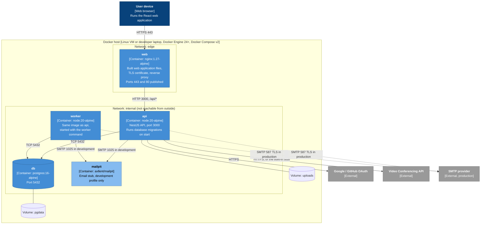

# Deployment

**Project:** Token-Based Peer-to-Peer Learning Platform
**Sprint:** 2 – Requirements and Architecture
**Owner:** Arda Eyce (Architect)
**GitHub issue:** #98 (UML deployment diagram), part of #93

The whole platform runs on one Docker host with Docker Compose. The same Compose file is used on a developer laptop and on the demo server; only the environment variables change (NFR-19, NFR-20, NFR-21). The implementation starts after this sprint, so image names, file names and default values below describe the planned set-up.

## 1. Deployment diagram

## 2. Deployment nodes

| Service | Image | Ports | Volumes | Restart and health |
|---|---|---|---|---|
| `web` | `nginx:1.27-alpine` with the built web application copied in | 443 and 80 published; 80 redirects to 443 | TLS certificate mounted read-only | `restart: unless-stopped`; starts after `api` is healthy |
| `api` | Project image built from `backend/Dockerfile` on `node:20-alpine` | 3000, internal only | `uploads` mounted at `/app/uploads` | Health check `GET /api/health`; waits for a healthy `db` |
| `worker` | Same image as `api`, command `node dist/worker.js` | None | None | `restart: unless-stopped`; waits for a healthy `db` |
| `db` | `postgres:16-alpine` | 5432, internal only | `pgdata` mounted at `/var/lib/postgresql/data` | Health check `pg_isready` |
| `mailpit` | `axllent/mailpit` | 8025 (web inbox) on localhost only | None | Only in the `dev` Compose profile |

Only the `web` service publishes ports. The database and the API are on the `internal` network, so they cannot be reached from outside the host (NFR-04, NFR-06).

## 3. Configuration

All settings come from an `.env` file read by Docker Compose; no source code changes are needed to move between environments (NFR-21). A committed `.env.example` lists every variable without secret values.

| Variable | Used by | Example | Purpose |
|---|---|---|---|
| `DATABASE_URL` | api, worker | `postgresql://app:***@db:5432/tokens` | Database connection |
| `JWT_SECRET` | api | (secret) | Signs the access tokens |
| `JWT_TTL_MINUTES` | api | `60` | Lifetime of an access token |
| `GOOGLE_CLIENT_ID`, `GITHUB_CLIENT_ID` | api | (from the provider) | OAuth sign-in |
| `VIDEO_PROVIDER` | api | `stub`, `zoom` or `meet` | Chooses the meeting adapter |
| `EMAIL_PROVIDER` | api, worker | `stub` or `smtp` | Chooses the email adapter |
| `SMTP_URL` | api, worker | `smtp://mailpit:1025` | Email server |
| `WELCOME_GRANT_TOKENS` | api | `10` | Welcome balance (FR-06) |
| `DISPUTE_WINDOW_HOURS` | api, worker | `24` | Time after the lesson end until `disputeDeadline` (BR-08) |
| `REPEAT_BOOKING_LIMIT` | api | `3` | Bookings with the same educator per 30 days (BR-12) |
| `PUBLIC_BASE_URL` | api, worker | `https://localhost` | Links in emails |

## 4. Start-up

1. Copy `.env.example` to `.env` and fill in the secrets.
2. Run `docker compose up -d` (add `--profile dev` for the email stub).
3. Compose starts `db` first, then `api` and `worker` when `db` is healthy, and then `web`.
4. The `api` container applies the database migrations (`prisma migrate deploy`) before it starts listening, so a fresh database is ready without manual steps.

This is the single command required by NFR-20. Backups are taken with `pg_dump` from the `db` container; the `pgdata` and `uploads` volumes keep the data when containers are recreated.
