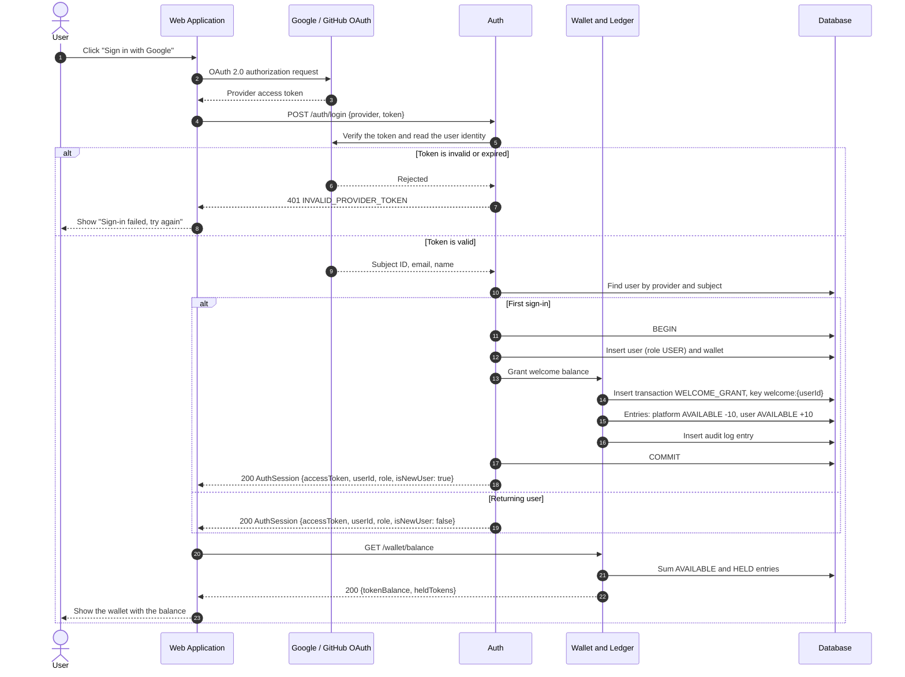
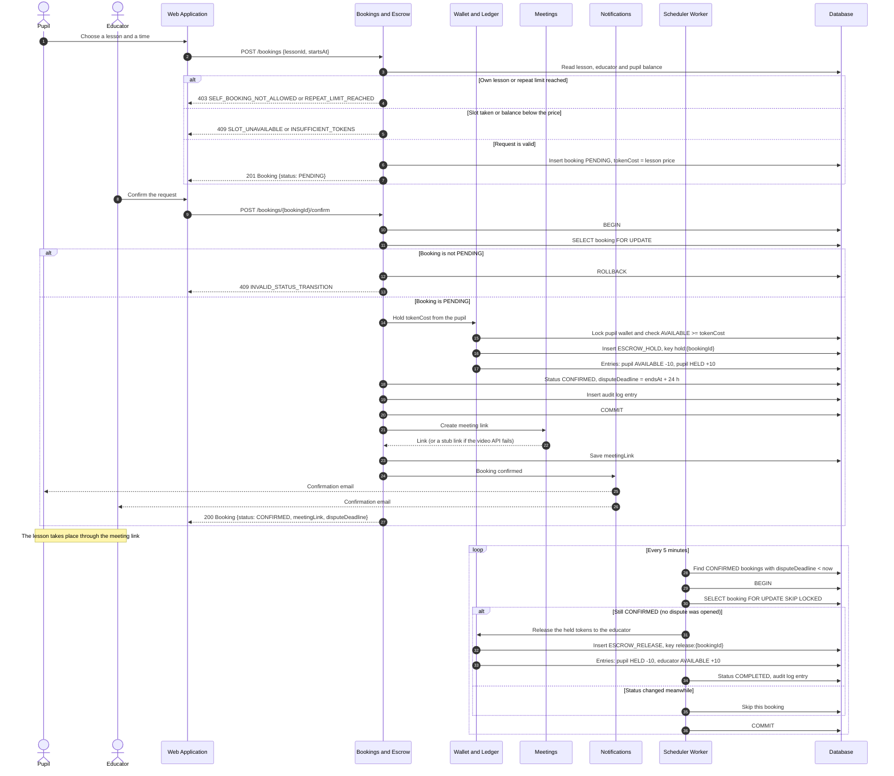
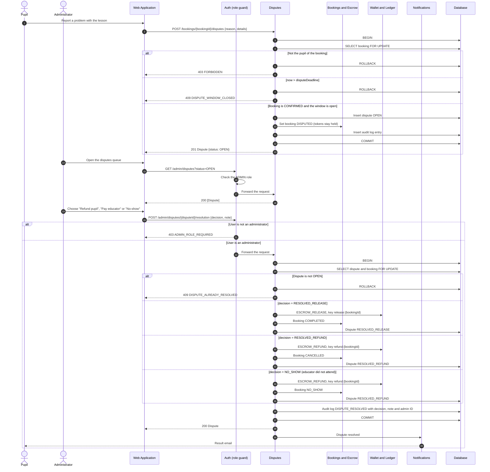

# Sequence Diagrams

**Project:** Token-Based Peer-to-Peer Learning Platform
**Sprint:** 2 – Requirements and Architecture
**Owner:** Arda Eyce (Architect)
**GitHub issue:** #97 (UML sequence diagrams), part of #93

These diagrams show how the components from the [C4 model](c4-model.md) work together in the three most important flows. Requests and responses use the paths and error codes of [openapi.yaml](../../openapi.yaml). `BEGIN` and `COMMIT` mark one PostgreSQL transaction: everything between them succeeds or fails together.

## 1. Sign-in with the welcome grant (US-01, US-03)

On the first sign-in the account, the wallet and the welcome grant are created in one transaction. The `welcome:{userId}` unique key means the grant can never be paid twice, even if the same request arrives twice (FR-06, NFR-08).

**Notes:**

- The access token is a short-lived JWT signed by the API. The web application keeps it in memory and sends it as `Authorization: Bearer` on every request.
- No password is stored; the user is identified by the provider and the provider's subject ID (NFR-06).

## 2. Booking, confirmation with escrow, and completion (US-09, US-10, US-12)

The pupil requests a slot, the educator confirms it, and the scheduler completes the lesson 24 hours after it ends. Tokens move only at confirmation (hold) and at completion (release).

**Notes:**

- The price is read from the lesson on the server; the request contains no price (BR-01).
- The balance is checked again inside the confirm transaction, because it may have changed since the request. If it is now too low, the transaction is rolled back and 409 `INSUFFICIENT_TOKENS` is returned.
- The meeting link and the emails are created **after** `COMMIT`. If the video API or the email service fails, the booking stays `CONFIRMED`; the failure is logged and retried (BR-11).
- `FOR UPDATE SKIP LOCKED` lets the job skip a booking that a dispute request is changing at the same moment. The job picks it up on the next run, and then it is no longer `CONFIRMED` (BR-13).

## 3. Dispute and administrator resolution (US-13, US-14)

A pupil can open a dispute until `disputeDeadline`. The tokens stay held until an administrator decides.

**Notes:**

- The administrator never edits a balance. Every decision is an escrow ledger transaction written in the same database transaction as the status changes (BR-03, FR-21).
- The `release:` and `refund:` keys of a booking can each exist only once, and a booking has either a release or a refund, never both. A double click on "Refund pupil" therefore cannot pay twice (NFR-08).
- The same row lock as in flow 2 guarantees that the automatic completion and a dispute cannot both succeed (BR-13).
