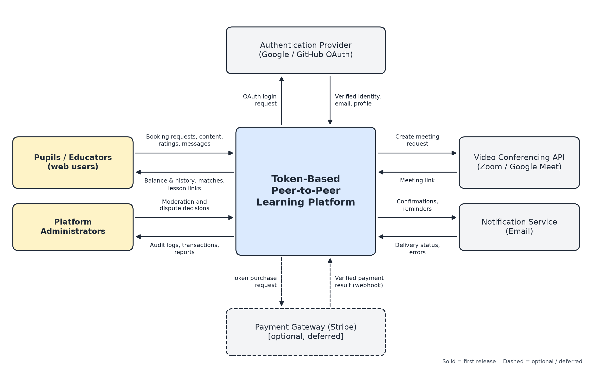

# Deliverable 2: System Vision and Boundary

**Project:** Token-Based Peer-to-Peer Learning Platform
**Owner:** Arda Eyce (Architect)
**GitHub issue:** #7

---

## 1. Vision Statement

> For university students and self-learners who want to gain new skills but cannot afford traditional paid courses, the **Token-Based Peer-to-Peer Learning Platform** is a web-based learning marketplace that lets users earn tokens by teaching what they know and spend those tokens to learn from their peers. Unlike paid tutoring and course platforms, it replaces money with an internal token economy, so knowledge itself becomes the currency. The first release supports web users and exposes an API contract for implementation and testing.

### 1.1 Project Purpose

The purpose of this project is to create a system where people earn tokens by teaching skills to others and spend those tokens to learn from other users. The platform aims to:

- lower the overall cost of education by replacing payments with a token exchange;
- make learners active participants, since every user can also teach;
- improve the pupil and educator experience through ratings, matching, and simple scheduling;
- make learning more engaging by gamifying it with tokens and user scores.

This is especially helpful for students who do not have enough money to improve their skills, whether for academic purposes or personal interest.

### 1.2 Target Users

| User group | Description | Main goals |
|---|---|---|
| Pupils (Learners) | Students and individuals who want to acquire new skills or academic help but lack the budget for expensive courses. | Find a suitable educator, book a lesson, pay with tokens. |
| Educators (Tutors / Content Creators) | Users who teach subjects in which they have expertise through live sessions, short lessons, and shared materials. The same account can act as both pupil and educator. | Publish skills and availability, teach, earn tokens, build a good score. |
| Platform Administrators | The team that operates the platform and governs the token economy. | Monitor transactions, resolve disputes, moderate content. |

## 2. System Responsibilities and Core Functionalities

The responsibilities below are owned by our system. Services that are only used by the system are listed in Section 3.

| Responsibility | Description |
|---|---|
| Identity and profile | Sign users in through an external OAuth provider and manage profiles, including skills, interests, and availability. |
| Token ledger (wallet) | Record every token movement as a traceable ledger entry. The balance is derived from the ledger and cannot go below zero. New tokens enter the system only from a platform account (welcome balances and content rewards), so the origin of every token is known. Administrator corrections are recorded as new compensating entries; balances are never edited directly. |
| Lesson payment (escrow) | The token cost of a lesson is always taken from the educator's lesson listing stored on the server, never from the booking request. When a booking is confirmed, the pupil's tokens are held; they are released to the educator when the lesson is completed and refunded if the lesson is cancelled or the educator does not attend. |
| Price guidance | Educators set the token price of their lessons. The system suggests a price based on the average price of similar lessons (same subject and level), keeps prices within ±50% of that average, and shows both the educator and the pupil whether a price is below, around, or above it. |
| Educator matching | Connect pupils with educators using rule-based filtering on subject, available time slots, educator rating, and the pupil's token balance. No machine-learning model is used. |
| Lesson booking and scheduling | Manage availability slots and one-to-one lesson requests, and prevent overlapping bookings. Users cannot book their own lessons. Booking status: pending, confirmed, completed, cancelled, no-show, disputed. A lesson is marked completed automatically 24 hours after its end time unless the pupil opens a dispute, which an administrator resolves. |
| Live session links | Request a meeting link from an external video conferencing service and share it only with the booked participants. The platform does not implement video streaming itself. |
| Ratings and user score | Let pupils and educators rate each other once per completed lesson and maintain a user score that reflects satisfaction. |
| Content sharing and rewards | Let educators publish short lessons and documents on their profile. Content is free for learners. The platform rewards the educator with a small, capped number of tokens based on how many unique users use the content (for example, 1 token per 10 unique users, up to 20 tokens per month); only users who have completed at least one lesson are counted. |
| Messaging | Provide basic, booking-related text messages between a pupil and an educator, for example to agree on lesson details. Real-time chat is not part of the first release: it needs continuous moderation, adds real-time infrastructure, and increases the risk of abuse between strangers. It can be added in a later release. |
| Notifications | Send booking confirmations and lesson reminders through an external notification service. |
| Administration | Provide audit logs and transaction history, report handling, and dispute resolution tools for administrators. |

## 3. System Context and External Interactions

Figure 1 shows the system boundary. Everything inside the central box is built by the team; everything outside is either a user group or an external service that the system integrates with.

*Figure 1. System context diagram. Solid lines are part of the first release; dashed lines are optional or deferred.*

Each relationship is reviewed for the information exchanged, its direction, its purpose, and the trust assumption the system makes:

| External party | Information and direction | Purpose | Trust assumption |
|---|---|---|---|
| Pupils / Educators | In: booking requests, content, ratings, messages. Out: balance and history, matches, lesson links. | Core use of the platform | All input is untrusted and validated on the server; every request must carry a valid access token. |
| Platform Administrators | In: moderation and dispute decisions. Out: audit logs, transactions, reports. | Governance of the token economy | Administrative actions require an administrator role and are themselves logged. |
| Authentication Provider (Google / GitHub OAuth) | Out: login request. In: verified identity, email, profile data. | User sign-in | Only provider tokens verified on the server are accepted; the platform never stores passwords. |
| Video Conferencing API (Zoom / Google Meet) | Out: create-meeting request. In: meeting link. | Live lessons | An outage only affects the link, never the booking or the token ledger. |
| Notification Service (Email) | Out: confirmations and reminders. In: delivery status and errors. | Keeping users informed | Delivery is best-effort; a failed message never changes booking state. |
| Payment Gateway (Stripe), optional | Out: token purchase request. In: payment result via webhook. | Buying tokens with money (deferred) | Tokens are credited only after a verified, signed payment result. |

## 4. In-Scope and Out-of-Scope Features

### 4.1 In Scope (First Release)

- User registration and login via Google/GitHub OAuth, and profile management.
- Token wallet with balance and transaction history (virtual tokens stored in our own database).
- A fixed welcome balance for new users (for example, 10 tokens), so they can take their first lesson before teaching.
- Educator-set lesson prices with a system-suggested price, a ±50% price range, and an above/around/below-average indicator shown to both sides.
- Rule-based educator search and matching.
- One-to-one lesson requests, booking, and calendar scheduling, with tokens held in escrow until the lesson is completed.
- Lesson completion and dispute handling (automatic completion after 24 hours unless disputed).
- Lesson meeting links generated through an external video conferencing API.
- Review, rating, and user score system.
- Tools for creating and sharing free content (short lessons and documents), with capped token rewards based on usage.
- Basic booking-related text messaging between pupils and educators.
- Email notifications for bookings and reminders.
- Basic administration: audit logs, reports, and dispute handling.

### 4.2 Out of Scope

- Blockchain or cryptocurrency integration; tokens are virtual points stored in an internal database.
- AI-powered recommendation engines or automated content generation.
- Our own video streaming or video chat infrastructure.
- Purchasing tokens with real money or converting tokens to money (payment gateway is deferred). Selling tokens would give them monetary value, so a legal review is required before this is added.
- Group lessons; the first release supports one-to-one lessons only.
- Real-time chat between users (can be added in a later release together with moderation tools).
- Homework assignment, submission, and review (can be added in a later release).
- Native mobile applications. The course project requires a web application, so the first release targets web browsers; mobile apps are considered for future releases.

## 5. Constraints and Assumptions

### 5.1 Constraints

| Type | Constraint |
|---|---|
| Schedule | Work must follow the SENG 321 academic calendar and sprint deadlines. |
| Resources | Six-person student team with no budget; only free tiers of external services can be used. |
| Technical | External services are accessed only through their public APIs. Token ledger integrity requires database transactions so that no tokens are lost or duplicated. |
| Legal | Personal data (profiles, messages, learning history) must be handled in line with data protection regulations (KVKK / GDPR). Tokens are virtual utility points with no monetary value, not financial instruments; they cannot be bought or sold for money in the first release. |
| Ethical | The platform must offer reporting tools for inappropriate content or behavior and a fair dispute process for token exchanges. |
| Fairness | Users cannot book their own lessons, repeated lessons between the same two users are limited, and content rewards are capped, so tokens cannot be farmed with fake accounts. |

### 5.2 Assumptions

| Assumption | Validation or response |
|---|---|
| Users have a stable internet connection and a device with a modern web browser. | Keep the interface lightweight and test it on common browsers. |
| Users have a Google or GitHub account to sign in with. | Confirm with the course stakeholder; email login can be added later if needed. |
| Enough educators will join to serve the pupils on the platform. | New users receive a fixed welcome balance so they can take a first lesson; supply and demand are monitored after launch. |
| Free tiers of the video conferencing and email APIs are sufficient for the project. | If an API is unavailable, use a documented local stub with the same boundary. |
| The team can learn the required technologies within the sprint timeline. | Share knowledge in team meetings and keep the first release scope small. |
