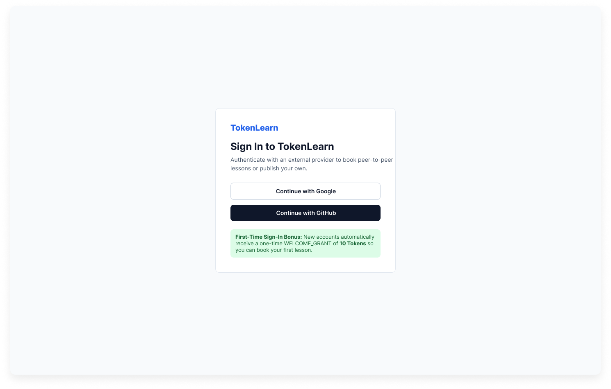
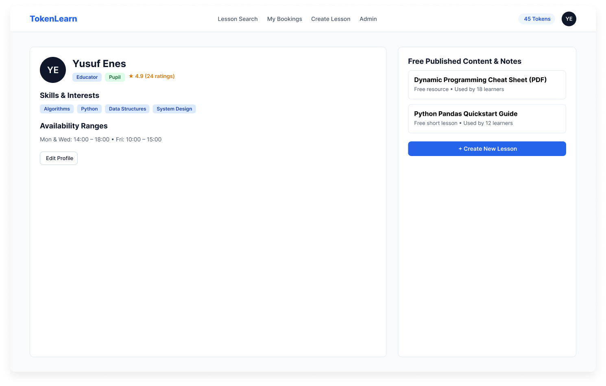
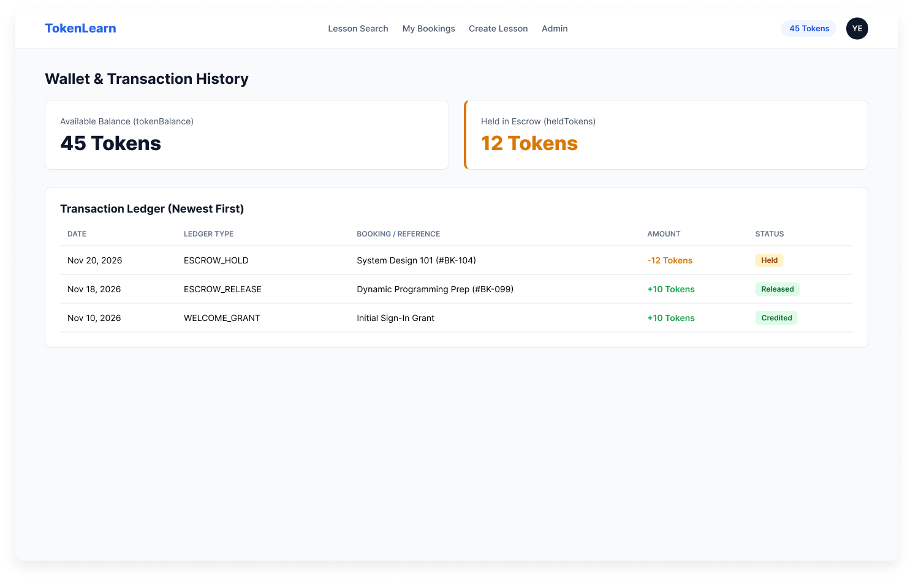
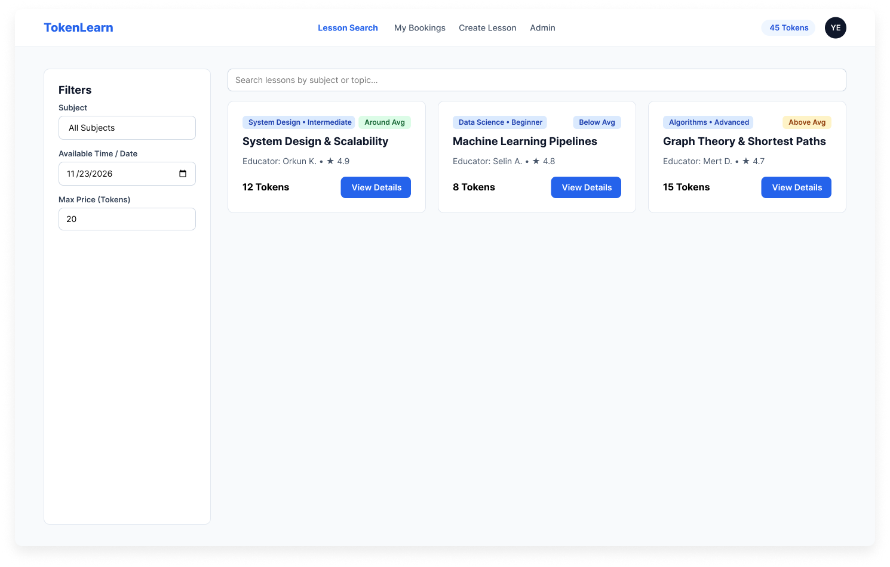
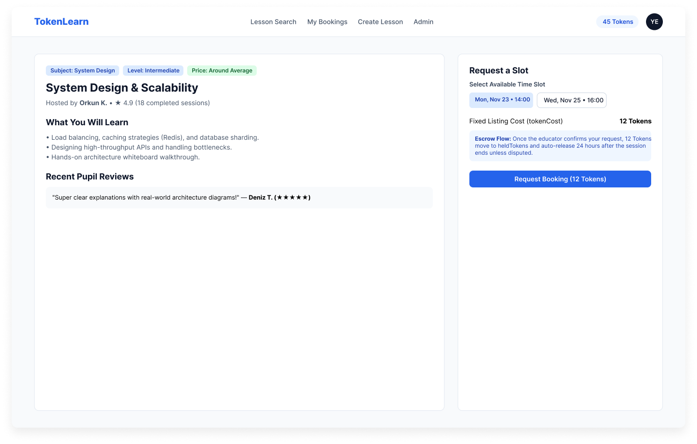
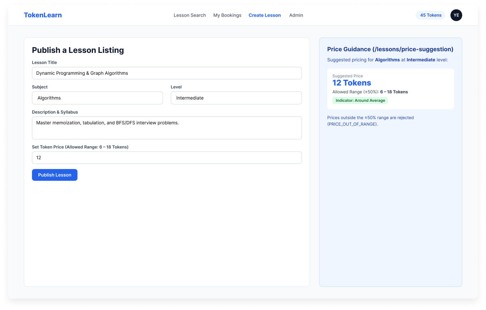
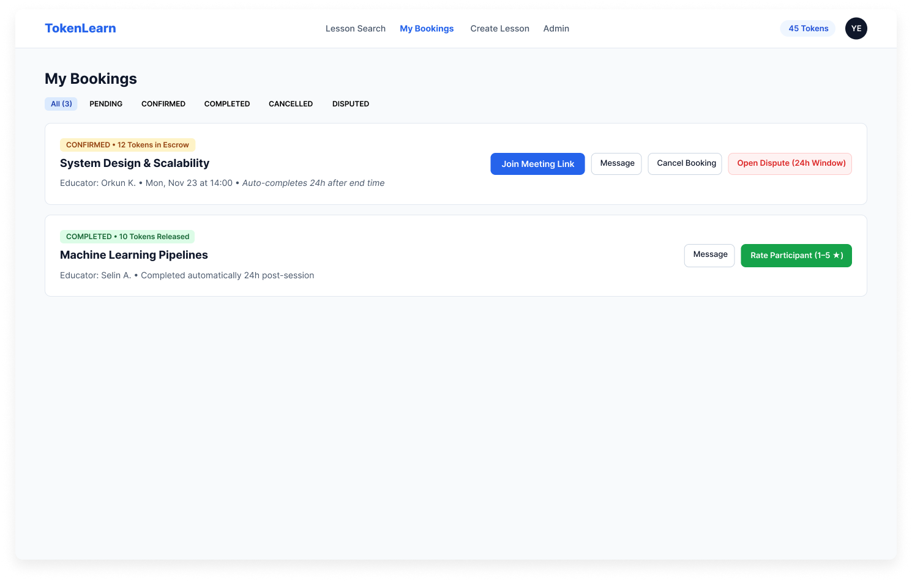
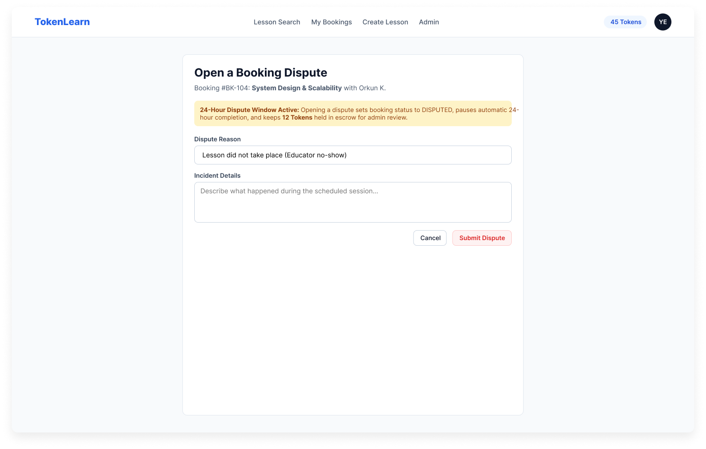
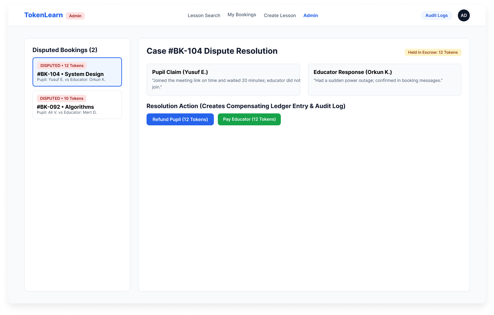

# UI/UX Designs & Screen Exports

This directory contains the exported UI screens, user flows, and Figma prototype documentation for the **Token Learning Platform**.

## Figma Prototype

- **Figma Design & Interactive Prototype:** <https://www.figma.com/design/WtbF65PsIM1vaXk9eADdyM/Token-Learning-Platform---Sprint-2-UI>

## Exported Screens & User Story Mapping

| # | Screen | Preview | Description | User Stories Served |
|---|---|---|---|---|
| 1 | **Sign-In & Welcome Balance** |  | OAuth sign-in screen supporting Google and GitHub authentication, displaying the one-time `WELCOME_GRANT` token credit on first sign-in. | **US-01** (Sign-in with external provider), **US-03** (Welcome balance) |
| 2 | **User Profile** |  | Displays and edits user skills, interests, availability ranges, ratings, and free published content. | **US-02** (User profile), **US-18** (Free content publishing) |
| 3 | **Wallet & Transaction History** |  | Shows available `tokenBalance` vs. `heldTokens` in escrow alongside a newest-first ledger of grants, holds, releases, and refunds. | **US-04** (View balance & held tokens), **US-05** (Transaction history) |
| 4 | **Lesson Search** |  | Searchable lesson catalog with subject, available date/time, and max-price filters plus below/around/above average price indicators. | **US-08** (Search lessons & price indicators) |
| 5 | **Lesson Detail & Booking** |  | Lesson overview, slot selection, and booking request view where `tokenCost` is copied from the listing and validated against balance. | **US-09** (Request lesson slot) |
| 6 | **Create Lesson (with Price Guidance)** |  | Educator listing creation form displaying suggested, minimum, and maximum token prices (±50% range) by subject and level. | **US-06** (Price guidance), **US-07** (Publish lesson listing) |
| 7 | **My Bookings** |  | Participant booking dashboard supporting confirmation/escrow hold, cancellation/refund, 24h auto-completion status, meeting links, messaging, and 1–5 ratings. | **US-10** (Confirm & hold escrow), **US-11** (Cancel & refund), **US-12** (Lesson completion), **US-15** (Meeting links), **US-17** (Mutual ratings), **US-20** (Booking messages) |
| 8 | **Dispute Submission** |  | Pupil dispute form opened within 24 hours of a missed/incomplete lesson, pausing auto-completion and keeping escrowed tokens held for admin review. | **US-13** (Open dispute) |
| 9 | **Admin Panel** |  | Administrative workspace for resolving disputes via compensating ledger entries (refund pupil or pay educator) and viewing audit logs/reported content. | **US-14** (Resolve dispute), **US-21** (Audit logs and reports) |
