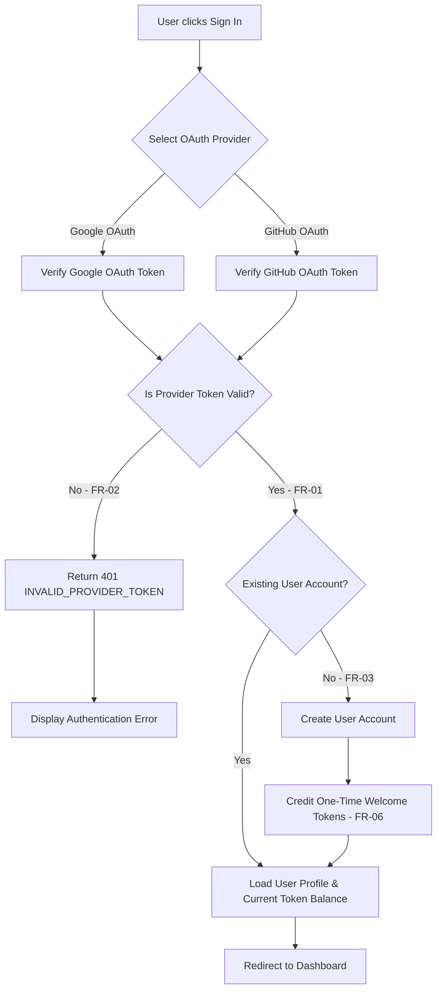
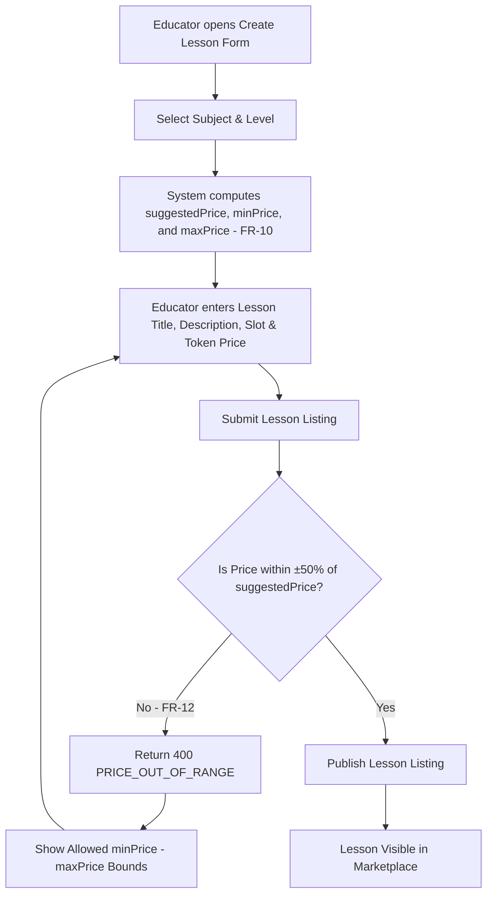
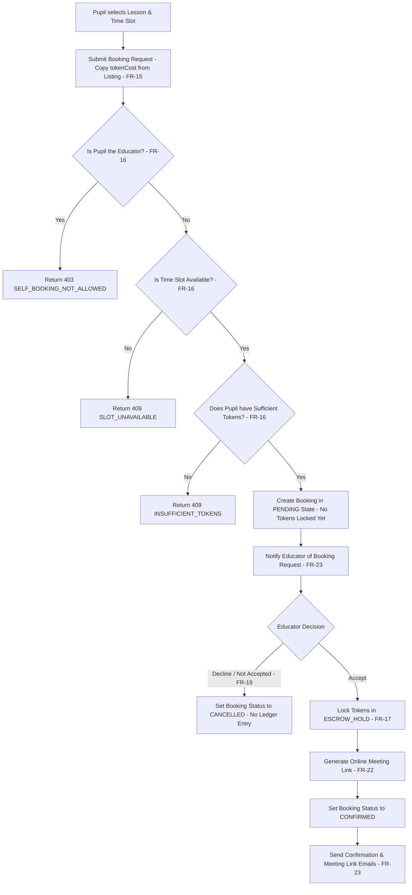
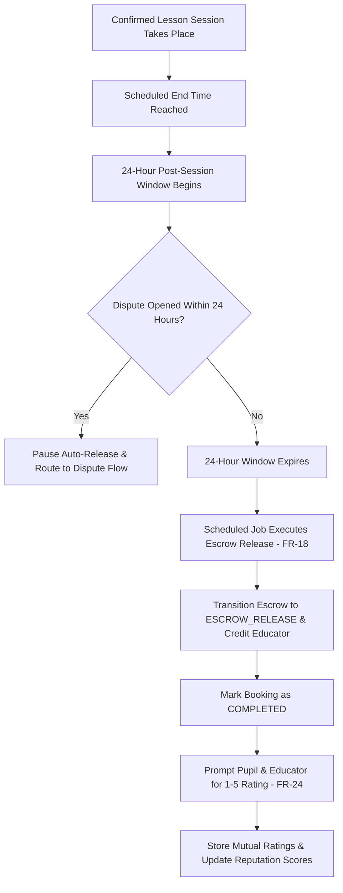
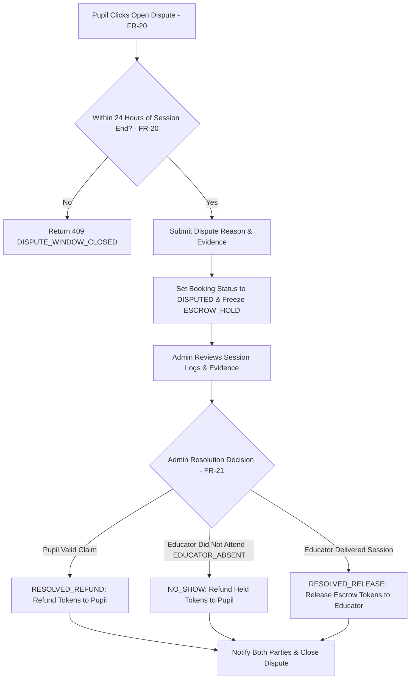

# User Flows – Token-Based Peer-to-Peer Learning Platform

This document illustrates the core end-to-end user journeys of the Token-Based Peer-to-Peer Learning Platform using Mermaid diagrams, aligned with the Software Requirements Specification (`docs/srs.md`).

---

## 1. Sign In, Account Provisioning, and Welcome Token

Users authenticate exclusively via Google or GitHub OAuth (`FR-01`). Invalid provider tokens are rejected (`FR-02`). On first successful sign-in, an account is provisioned (`FR-03`) and credited with a one-time welcome token allocation (`FR-06`).

---

## 2. Educator Lesson Publishing & Price Range Validation

Educators publish lesson offerings by specifying the subject, difficulty/level, schedule slot, and token price. The system calculates `suggestedPrice`, `minPrice`, and `maxPrice` (`FR-10`), and rejects prices outside the ±50% bounds (`FR-12`).

---

## 3. Escrow-Backed Lesson Booking

A pupil requests a booking (`PENDING`) and `tokenCost` is copied from the listing (`FR-15`). At request time, tokens are **not** locked yet. The system validates self-booking, slot availability, and pupil balance (`FR-16`). If the educator does not accept the request, the booking becomes `CANCELLED` with no ledger entry (`FR-19`). Once the educator accepts, tokens are locked in `ESCROW_HOLD` (`FR-17`), a meeting link is generated (`FR-22`), and notifications are sent (`FR-23`).

---

## 4. Lesson Completion, Automated Escrow Release, and Mutual Rating

There is no manual completion button. After the scheduled session ends, a 24-hour dispute window runs. If no dispute is raised within 24 hours, a scheduled job automatically transitions the escrow to `ESCROW_RELEASE` (`FR-18`) and transfers tokens to the educator. Both participants can submit a 1–5 star rating (`FR-24`).

---

## 5. Dispute Submission and Admin Resolution

Only the pupil may open a dispute within 24 hours after the scheduled session end (`FR-20`). Requests after the 24-hour window are rejected with `409 DISPUTE_WINDOW_CLOSED`. An administrator reviews the evidence and resolves the dispute with one of three outcomes (`FR-21`): `RESOLVED_REFUND`, `NO_SHOW` (`EDUCATOR_ABSENT`), or `RESOLVED_RELEASE`.

