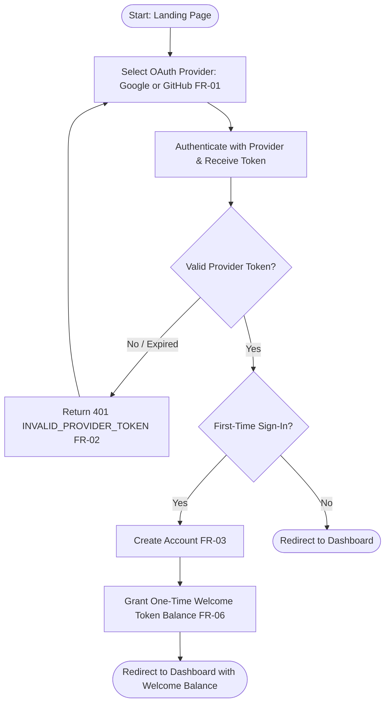
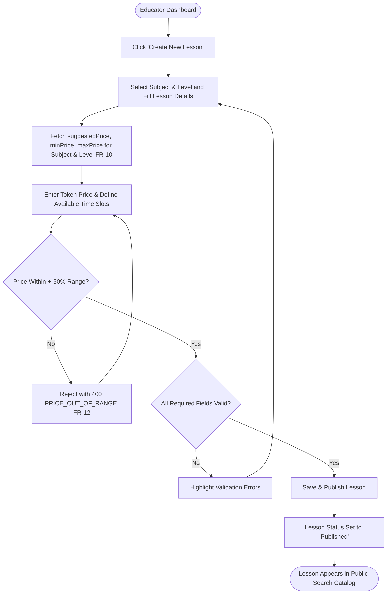

# User Flows

This document outlines the core end-to-end user flows for the **Token Learning Platform**, covering authentication, lesson publishing, escrow-backed booking, lesson completion, and dispute resolution.

---

## 1. Sign In and Welcome Balance



---

## 2. Educator Publishes a Lesson



---

## 3. Pupil Searches, Books, and Booking is Confirmed (Escrow)

```mermaid
flowchart TD
    A([Pupil Dashboard]) --> B[Search / Filter Lessons by Subject, Level, Price, Rating]
    B --> C[Select Lesson & View Details]
    C --> D[Choose Available Time Slot]
    D --> E[Click 'Request Booking']
    E --> F{Booking Rules Check FR-15, FR-16}
    F -- Own Lesson --> G[Return 403 SELF_BOOKING_NOT_ALLOWED]
    F -- Slot Taken --> H[Return 409 SLOT_UNAVAILABLE]
    F -- Low Balance --> I[Return 409 INSUFFICIENT_TOKENS]
    G --> J
