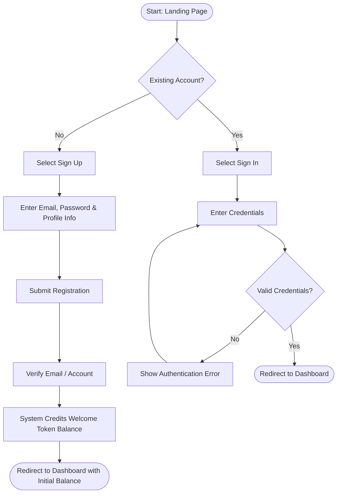
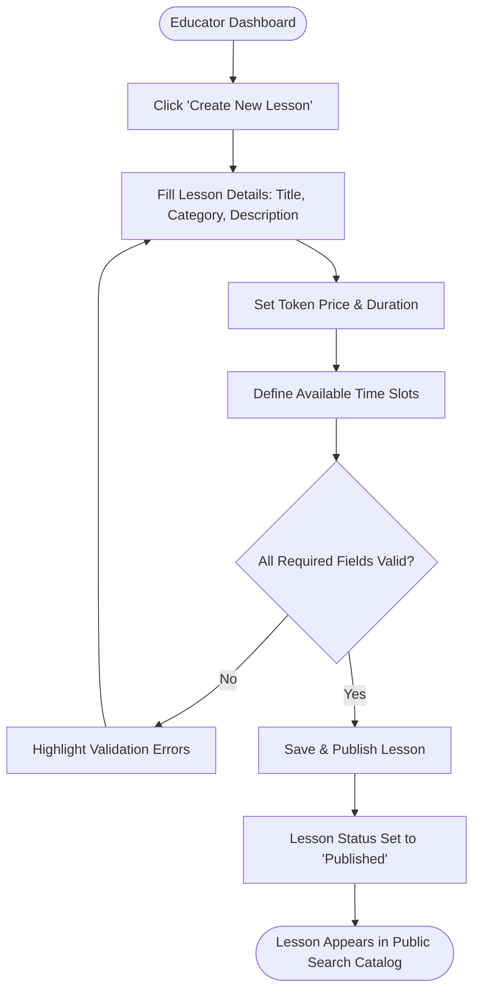
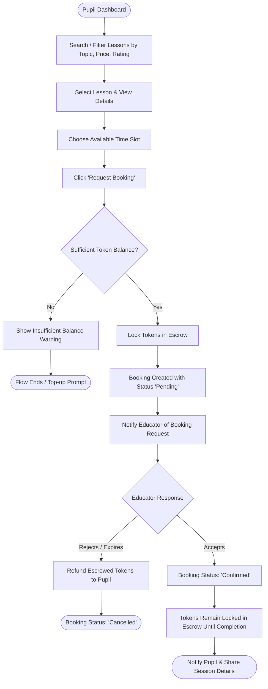
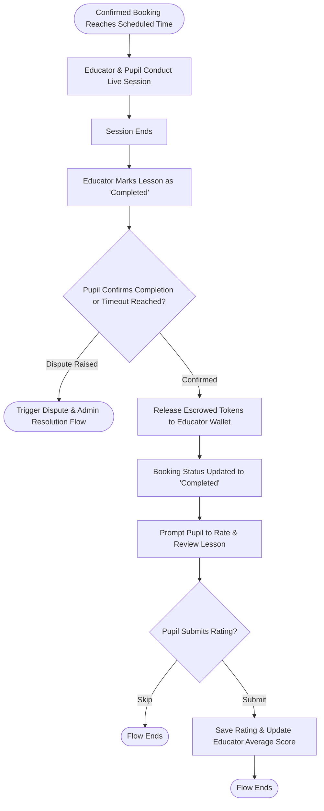
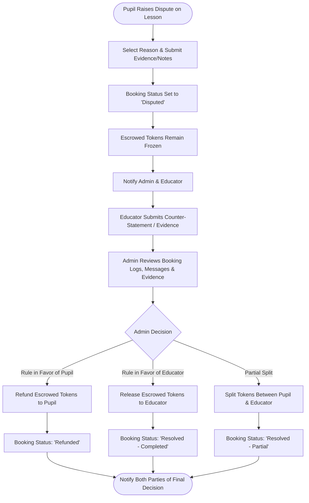

# User Flows

This document outlines the core end-to-end user flows for the **Token Learning Platform**, covering authentication, lesson publishing, escrow-backed booking, lesson completion, and dispute resolution.

---

## 1. Sign In and Welcome Balance

---

## 2. Educator Publishes a Lesson

---

## 3. Pupil Searches, Books, and Booking is Confirmed (Escrow)

---

## 4. Lesson Completion and Rating

---

## 5. Dispute and Admin Resolution

